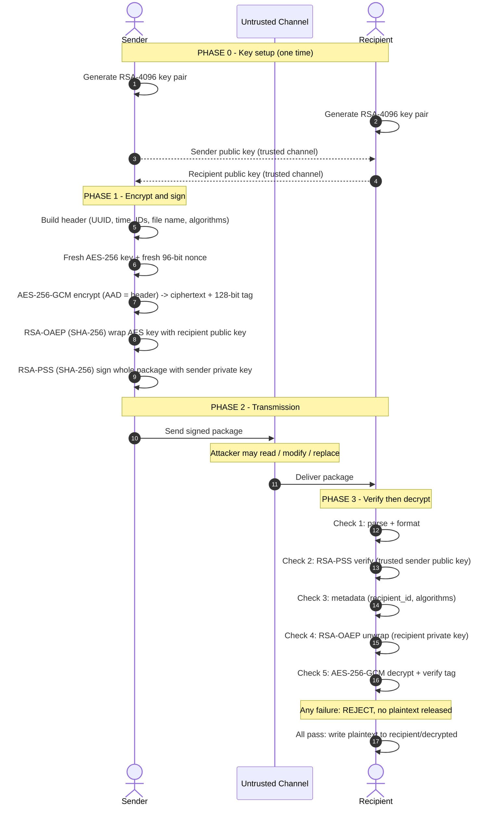

# Secure Examination-Paper Exchange

**Workshop project: hybrid encryption + digital signatures in Python (RSA-4096, AES-256-GCM, RSA-OAEP, RSA-PSS)**

---

## Table of Contents

1. [The problem in one minute](#1-the-problem-in-one-minute)
2. [Big picture: what the application does](#2-big-picture-what-the-application-does)
3. [Project and workshop folder structure](#3-project-and-workshop-folder-structure)
4. [Quick start](#4-quick-start)
5. [Step-by-step: how the code works](#5-step-by-step-how-the-code-works)
6. [Security explanation (detailed)](#6-security-explanation-detailed)
7. [Test results](#7-test-results)
8. [Sequence diagram](#8-sequence-diagram)
9. [Limitations and possible improvements](#9-limitations-and-possible-improvements)
10. [Deliverables checklist](#10-deliverables-checklist)
11. [Troubleshooting](#11-troubleshooting)
12. [Quick revision summary](#12-quick-revision-summary)

---

## 1. The problem

A faculty member (the **sender**) must send a confidential examination paper to an authorised examination coordinator (the **recipient**). The file travels through an **untrusted communication channel**. An attacker may:

* **read** the file (steal the paper),
* **modify** the file (change questions, swap in a different paper),
* **replace** the file with a fake paper and attempt to make it appear as though it came from the authorised sender.

We need three guarantees:

| Guarantee | Plain-English question it answers |
|---|---|
| **Confidentiality** | Can anyone other than the authorised recipient read the paper? |
| **Integrity** | Has even a single bit been changed on the way? |
| **Sender authentication** | Was the package signed by the authorised sender, rather than an attacker? |

**Overall objective.** The application must keep the examination paper confidential, detect unauthorised changes, and allow the recipient to verify that the package was signed using the authorised sender's private key.

---

## 2. Big picture: what the application does

The application uses **hybrid cryptography**. Two kinds of cryptography are combined because each has a different strength:

| Tool | Type | Strength | Weakness | Used here for |
|---|---|---|---|---|
| **AES-256-GCM** | Symmetric (one shared key) | Very fast, handles big files, also detects tampering | Both sides need the same secret key | Encrypting the exam paper |
| **RSA-4096** | Asymmetric (public + private key pair) | No shared secret needed beforehand | Slow, can only handle small data | Protecting the AES key and signing |

**The idea in four sentences**

1. Make a brand-new random AES key just for this one file and lock the paper with it (fast).
2. Protect that AES key with the **recipient's public key**, so only the corresponding recipient private key can recover it.
3. Sign the whole package with the **sender's private key**, so the recipient can verify it using the trusted sender public key and detect changes to the signed package.
4. The recipient verifies the signature first, then recovers the AES key, and finally decrypts the paper. If any check fails, **no plaintext file is released**.

```
 SENDER                              UNTRUSTED CHANNEL                   RECIPIENT
 ------------------                   ------------------                  ------------------
 exam paper
   |  AES-256-GCM (fresh key+nonce)
   v
 ciphertext + tag
   |  AES key wrapped by RSA-OAEP(recipient public key)
   v
 package = header + wrapped key + nonce + ciphertext + tag
   |  RSA-PSS signature (sender private key)
   v
 signed package  ----------------------->  (attacker may read/modify) --->  1 parse
                                                                             2 verify signature (trusted sender public key)
                                                                             3 check metadata
                                                                             4 unwrap AES key (recipient private key)
                                                                             5 AES-GCM decrypt + verify tag
                                                                             6 release paper
```

---

## 3. Project and workshop folder structure

There are **two levels** to understand:

* the **project folder** `secure_exam/`, which holds the code you write and submit;
* the **`workshop/` folder**, which the simulation **creates automatically** when you run `run_simulation.py`. It represents separate Sender, Recipient, and Attacker roles, together with the communication channel, using folders on one computer.

> Every time you run `run_simulation.py`, the old `workshop/` folder is **deleted and rebuilt** from scratch, so you always get fresh keys and fresh results.

### 3.1 Project folder (source code)

```
secure_exam/
├── secure_exam.py        <- the application: key generation, encrypt, decrypt, CLI
├── run_simulation.py     <- builds the workshop folders and runs all tests
├── requirements.txt      <- Python dependency list (cryptography)
├── test_results.txt      <- copy of the simulation output (test evidence)
├── README.md             <- this report
└── workshop/             <- created by run_simulation.py (see 3.2)
```

### 3.2 The `workshop/` folder (the simulated environment)

```
workshop/
│
├── sender/                         <- sender role
│   ├── keys/
│   │   ├── sender_private.pem          sender PRIVATE key (passphrase-encrypted, never shared)
│   │   └── sender_public.pem           sender public key (can be shared)
│   ├── trusted_keys/
│   │   └── recipient_public.pem        recipient public key, received over a trusted channel
│   ├── input/
│   │   └── exam_paper.txt              the sample confidential exam paper (plaintext)
│   └── outbox/
│       ├── exam_paper.pkg.json         encrypted + signed package (Test 1)
│       ├── run_A.pkg.json              first encryption of the same file (Test 5)
│       └── run_B.pkg.json              second encryption of the same file (Test 5)
│
├── untrusted_channel/              <- the network / email / USB stick
│   └── exam_paper.pkg.json             the package while in transit (attacker can touch it)
│
├── recipient/                      <- recipient role
│   ├── keys/
│   │   ├── recipient_private.pem       recipient PRIVATE key (passphrase-encrypted)
│   │   └── recipient_public.pem        recipient public key
│   ├── trusted_keys/
│   │   └── sender_public.pem           sender public key, received over a trusted channel
│   ├── inbox/
│   │   └── exam_paper.pkg.json         package as received
│   └── decrypted/
│       ├── exam_paper.txt              recovered paper (Test 1)
│       ├── A/exam_paper.txt            recovered from run_A (Test 5)
│       └── B/exam_paper.txt            recovered from run_B (Test 5)
│
├── attacker/                       <- attacker role
│   ├── keys/
│   │   ├── attacker_private.pem        attacker's private key for forgery tests
│   │   └── attacker_public.pem         attacker's public key for wrong-key tests
│   ├── tampered/
│   │   ├── tampered_ciphertext.json            one bit flipped in ciphertext
│   │   ├── tampered_header.json                metadata (file_name) edited
│   │   ├── tampered_signature.json             one bit flipped in signature
│   │   ├── tampered_tag.json                   one bit flipped in GCM tag
│   │   ├── tampered_nonce.json                 one bit flipped in nonce
│   │   ├── tampered_encrypted_session_key.json one bit flipped in wrapped key
│   │   ├── forged_replacement.json             replacement package created and signed by the attacker
│   │   ├── junk.json                           truncated / garbage file
│   │   └── resigned_bad_ct.json                bad ciphertext but with a VALID signature
│   └── (no decrypted/ folder)              it is never created: the attacker receives no plaintext
│
└── test_results.txt                <- log written by the simulation
```

### 3.3 Who owns which key (very important)

| Key | Lives in | Who may see it | Purpose |
|---|---|---|---|
| `sender_private.pem` | `sender/keys/` | **Only the sender** | Create signatures |
| `sender_public.pem` | `sender/keys/` and `recipient/trusted_keys/` | Everyone | Verify the sender's signatures |
| `recipient_private.pem` | `recipient/keys/` | **Only the recipient** | Unwrap the AES session key |
| `recipient_public.pem` | `recipient/keys/` and `sender/trusted_keys/` | Everyone | Wrap the AES session key for the recipient |
| `attacker_*.pem` | `attacker/keys/` | Attacker role | Used to test wrong-key and forgery scenarios |

Copying each participant's public key into the other participant's `trusted_keys/` folder represents the condition stated in the workshop brief: *public keys are exchanged through a trusted channel*. Private keys are not exchanged.

---

## 4. Quick start

### 4.1 Setup (recommended: virtual environment)

Requires Python 3.9+. A virtual environment ties the `cryptography` library to the exact Python that runs the scripts and avoids "externally managed" and "wrong interpreter" errors (see section 11).

**Windows (Command Prompt / VS Code terminal)**
```
cd secure_exam
python -m venv .venv
.venv\Scripts\activate
python -m pip install -r requirements.txt
python run_simulation.py
```

**Linux / macOS**
```bash
cd secure_exam
python3 -m venv .venv
source .venv/bin/activate
python -m pip install -r requirements.txt
python run_simulation.py
```

**Using uv instead (if installed)**
```
uv venv
uv pip install -r requirements.txt
uv run python run_simulation.py
```

After activation the prompt starts with `(.venv)`. In a new terminal, activate again before running the scripts. The simulation takes about 10-30 s (mostly RSA-4096 key generation) and ends with `13/13 checks passed`.

Verify the install any time:
```
python -c "import cryptography; print(cryptography.__version__)"
```

### 4.2 Manual use with the command line

The passphrase is prompted, or read from the `EXAM_KEY_PASSPHRASE` environment variable.

```bash
# 1. each party generates its own key pair
python secure_exam.py keygen --name sender    --out-dir sender/keys
python secure_exam.py keygen --name recipient --out-dir recipient/keys
# 2. exchange *public* keys over a trusted channel (copy into trusted_keys/)

# 3. sender encrypts + signs
python secure_exam.py encrypt --input paper.pdf --output paper.pkg.json \
    --sender-key sender/keys/sender_private.pem \
    --recipient-pub sender/trusted_keys/recipient_public.pem \
    --sender-id faculty.sender --recipient-id exam.coordinator

# 4. recipient verifies + decrypts
python secure_exam.py decrypt --package paper.pkg.json \
    --recipient-key recipient/keys/recipient_private.pem \
    --sender-pub recipient/trusted_keys/sender_public.pem \
    --recipient-id exam.coordinator --out-dir recipient/decrypted
```

Exit code is `0` on success and `1` on rejection, with a message such as `REJECTED [SignatureVerificationError]: ...` on the error stream.

---

## 5. Step-by-step: how the code works

### 5.1 Key generation and storage (requirement 1)

* Each party generates its own **RSA-4096** key pair with public exponent 65537. Keys below 3072 bits are refused when loaded.
* **Private key** is saved as PKCS#8 PEM, **encrypted with a passphrase**, with file mode `0600` (owner read/write only). Files are created atomically with `O_EXCL`, so an existing key is never silently overwritten.
* **Public key** is saved as SubjectPublicKeyInfo PEM and can be freely shared.
* Keys are always **reloaded from disk** in the simulation, exactly as a real run would do.

### 5.2 The package format

The encrypted file is a JSON document with these fields:

| Field | What it contains | Size |
|---|---|---|
| `header` | Metadata: format, version, `package_id` (UUID), `created_utc`, `sender_id`, `recipient_id`, `file_name`, `plaintext_size`, algorithm suite | small |
| `encrypted_session_key` | The AES key wrapped with RSA-OAEP | 512 bytes |
| `nonce` | Random number used once for AES-GCM | 12 bytes (96 bit) |
| `ciphertext` | The encrypted exam paper | same length as the paper |
| `tag` | GCM authentication tag | 16 bytes (128 bit) |
| `signature` | RSA-PSS signature over everything above | 512 bytes |

Binary fields are Base64-encoded so the package stays plain text.

### 5.3 Sender algorithm (requirements 2, 3, 4)

1. **Read** the exam paper and **build the header** (metadata).
2. **Generate a fresh AES-256 session key and a fresh 96-bit nonce** from the operating system's secure random generator. They are never reused.
3. **Encrypt with AES-256-GCM**: `ciphertext, tag = AES-GCM(session_key, nonce, plaintext, AAD = header)`. The header is bound in as *Additional Authenticated Data*.
4. **Wrap the session key**: `encrypted_session_key = RSA-OAEP(recipient_public, session_key)` using SHA-256 and MGF1-SHA256.
5. **Sign the complete package** with `RSA-PSS(sender_private)` using SHA-256, MGF1-SHA256 and a 32-byte salt. The signed bytes are a *length-prefixed* concatenation of: domain-separation label, header, wrapped key, nonce, ciphertext, tag.
6. **Write** the package JSON to the outbox.

### 5.4 Recipient algorithm (requirements 5 and 6)

Checks run in this strict order. The plaintext exists **only in memory** until the very last step.

| Step | Check | Error raised if it fails |
|---|---|---|
| 1 | Valid JSON, exactly the expected fields, valid Base64, correct nonce/tag lengths | `PackageFormatError` |
| 2 | **RSA-PSS signature** verified with the **trusted** sender public key over the complete package | `SignatureVerificationError` |
| 3 | Metadata policy: format/version, algorithm suite, and whether `recipient_id` matches the intended recipient | `MetadataError` |
| 4 | **RSA-OAEP** unwrap of the session key with the recipient's private key | `SessionKeyError` |
| 5 | **AES-GCM** decrypt, verifying tag and header (AAD) | `IntegrityError` |
| 6 | Write plaintext to disk (file name reduced to a base name to stop path-traversal tricks) | n/a |

Every rejection shows a **specific readable error** and writes **nothing** to disk.

---

## 6. Security explanation (detailed)

### 6.1 Security model and simulation conditions

| Item | Assumption |
|---|---|
| Communication channel | **Untrusted.** An attacker may read, modify, delete, replay or replace a package during transmission. |
| Public keys | Exchanged over a **trusted** channel, as specified in the workshop brief. The simulation assumes this initial exchange has not been compromised. |
| Private keys | Remain secret and are protected by passphrases. They are not shared between the sender and recipient. |
| Attacker capabilities | May know the algorithms and public keys and may create an independent key pair for the forgery tests (Kerckhoffs's principle: security depends on the keys, not on hiding the algorithms). |
| Cryptographic security assumption | The attacker cannot practically break correctly implemented RSA-4096 or AES-256, or guess a uniformly random 256-bit key. |

### 6.2 Confidentiality: only the authorised recipient can read the paper

**Goal.** Only the authorised recipient should be able to recover the examination paper.

**How it is achieved**

1. The paper is encrypted with **AES-256-GCM**. AES-256 has a 2^256 key space, so brute force is infeasible.
2. The AES key is **random and used for one file only** (a *session key*). Compromising one package never exposes another.
3. The AES key is not sent in the clear. It is wrapped with **RSA-OAEP using the recipient's public key**. Only the corresponding **recipient private key** can recover it.
4. **Why OAEP and not plain RSA?** Plain ("textbook") RSA is deterministic and malleable. OAEP adds random padding so the same key encrypts differently each time and is secure against chosen-ciphertext attacks. The older PKCS#1 v1.5 padding is vulnerable to Bleichenbacher-style padding-oracle attacks, so it is deliberately avoided.
5. **Why hybrid?** RSA-4096 can only encrypt a few hundred bytes and is very slow. AES handles the large file quickly, RSA only protects the 32-byte key.

**What an attacker can see:** the header (metadata, in the clear but authenticated), random-looking ciphertext, and the wrapped session key. Without the recipient private key, the attacker cannot recover the AES key.

**Evidence from tests**

* Test 1: a secret marker from the paper (`CS301-ES-2026-MASTER`) does **not** appear anywhere in the package.
* Test 3: An incorrect private key cannot unwrap the session key (`SessionKeyError`); no plaintext is released.
* Test 5: encrypting the same file twice gives completely different packages, so patterns do not leak.

**Honest note:** the header is not encrypted. It contains only the file name, size, IDs and timestamp. Do not put secrets in a file name.

### 6.3 Integrity: "nothing was changed"

**Goal.** If any signed part of the package changes, the recipient must detect it and release nothing.

Two **independent** layers protect integrity (defence in depth):

**Layer 1: RSA-PSS digital signature (whole package)**

* The signature covers the header, wrapped key, nonce, ciphertext and tag together. Changing any of them invalidates the signature.
* The signed bytes are **length-prefixed** (each field is preceded by its 8-byte length). This blocks "boundary-shifting" tricks where an attacker moves bytes from one field to another and keeps the total identical.
* A **domain-separation label** (`EXAM-PKG-SIG-v1`) is added so a signature made for this protocol cannot be reused in another context.
* The header is serialised in a **canonical form** (sorted keys, fixed separators) so signer and verifier always see identical bytes.

**Layer 2: AES-GCM authentication tag**

* GCM is *authenticated encryption*. It produces a 128-bit tag over the ciphertext **and** the header (passed as AAD). If anything differs, decryption fails with an invalid tag.
* Because the header is bound as AAD, an attacker cannot paste an old ciphertext under a different file name or recipient and have it accepted.

**Why two layers?** The signature is checked first and stops almost everything. The GCM tag is a safety net: Test 2g re-signs a tampered ciphertext using the *real* sender key (as if the signing key had leaked) and the GCM tag still rejects it.

**Why verify the signature BEFORE decrypting?** It follows the "cryptographic doom principle": never perform operations on data you have not authenticated. Forged input never reaches the private-key operation, which prevents oracle-style attacks and wasted work.

**Evidence from tests:** changing the ciphertext, metadata, signature, tag, nonce or wrapped key are all rejected, and no plaintext file is written.

### 6.4 Sender authentication: verifying the authorised sender

**Goal.** The recipient must verify that the package was signed using the authorised sender's private key, rather than an attacker's key.

**How it is achieved**

* The sender is the only participant who should hold `sender_private.pem`. A signature created with that key can be verified using the corresponding trusted `sender_public.pem`.
* The recipient verifies the signature using a **trusted copy** of the sender's public key (received through the trusted channel), **not** a key supplied inside the package. Otherwise, an attacker could attach their own public key and claim it belongs to the sender.
* **The forgery attack.** Anyone can encrypt a package for the recipient because the recipient's public key is public. Confidentiality alone does **not** prove who sent it. The digital signature is therefore essential. A replacement package created by an attacker may be encrypted correctly, but if it is signed with the attacker's key, verification with the trusted sender public key fails.
* PSS is a randomised, provably secure signature padding (preferred over older PKCS#1 v1.5 signatures).
* Signed metadata (`sender_id`, `recipient_id`, `package_id`, timestamp) identifies the claimed sender and intended recipient. The recipient rejects packages addressed to a different recipient.

**Evidence from tests**

* Test 2e: a complete replacement package signed by the attacker is rejected.
* Test 4: verifying with an incorrect sender public key fails, proving that verification depends on the corresponding trusted key.

**Additional property: non-repudiation.** A valid signature provides evidence that the package was signed using the sender's private key. This depends on the private key remaining under the sender's exclusive control and does not, by itself, prove who physically operated the device.

### 6.5 Design choices at a glance (why each one is there)

| Design choice | Attack or mistake it prevents |
|---|---|
| Fresh random AES key per file | One leaked key exposes only one file |
| Fresh random 96-bit nonce per encryption | **Nonce reuse in GCM is catastrophic** (leaks plaintext XOR and allows tag forgery) |
| AES-GCM (authenticated encryption) | Silent modification of ciphertext |
| Header as AAD | Swapping metadata (file name, recipient) around a valid ciphertext |
| RSA-OAEP, not PKCS#1 v1.5 or textbook RSA | Padding-oracle and chosen-ciphertext attacks on the wrapped key |
| RSA-PSS, not PKCS#1 v1.5 signatures | Weaker signature padding schemes |
| Sign the **complete** package | Modification of the wrapped key, nonce, tag or metadata |
| Length-prefixed signing input | Field-boundary ambiguity |
| Domain-separation label | Cross-protocol signature reuse |
| Verify signature first | Processing unauthenticated, attacker-controlled data |
| Trusted public-key copy | An attacker supplying their own key as though it belonged to the sender |
| RSA-4096 and 3072-bit minimum on load | Weak or short keys |
| Encrypted private key + `0600` permissions | Theft of the key file from disk |
| Plaintext written only after all checks | Leaking unverified plaintext |
| Base name only for output file | Path traversal such as `../../evil` |
| Exact-field-set and length checks | Malformed or ambiguous packages |
| Well-known library (`cryptography`) | Home-made crypto bugs |

### 6.6 Attack scenarios and how each one fails

| Attack scenario | Where it is stopped | Result |
|---|---|---|
| Reads the package to obtain the paper | Cannot unwrap the AES key without the recipient's private key | Only ciphertext is visible |
| Flips a bit in the ciphertext | Signature check (step 2), GCM tag as backup | Rejected |
| Edits metadata, e.g. file name | Signature check; header is also GCM AAD | Rejected |
| Modifies or replaces the signature | Signature check | Rejected |
| Replaces the package with one signed using an attacker key | Signature check with the trusted sender public key | Rejected |
| Sends garbage or truncated data | Format check (step 1) | Rejected |
| Recipient uses the wrong private key | OAEP unwrap fails (step 4) | Rejected |
| Recipient uses the wrong sender public key | Signature check fails (step 2) | Rejected |
| Valid signature but modified ciphertext (leaked signing key) | GCM tag check (step 5) | Rejected |
| Package addressed to a different recipient | Metadata check (step 3) | Rejected |
| Replays an old valid package | **Not blocked** (see limitations) | Accepted |

---

## 7. Test results

Produced by `python run_simulation.py` and saved in `test_results.txt`.

| # | Required scenario | Result | Observed outcome |
|---|---|---|---|
| 1 | Authorised recipient recovers file | PASS | Decrypted file identical to the original |
| 2a | Ciphertext modified | PASS | `SignatureVerificationError`, no output |
| 2b | Metadata modified (`file_name`) | PASS | `SignatureVerificationError`, no output |
| 2c | Signature modified | PASS | `SignatureVerificationError`, no output |
| 2d | Extra: tag / nonce / wrapped key modified | PASS | `SignatureVerificationError` |
| 2e | Extra: attacker-signed replacement package | PASS | `SignatureVerificationError` |
| 2f | Extra: malformed file | PASS | `PackageFormatError` |
| 2g | Extra: valid signature but altered ciphertext | PASS | `IntegrityError` (GCM tag) |
| 3 | Wrong recipient private key | PASS | `SessionKeyError` |
| 4 | Wrong sender public key | PASS | `SignatureVerificationError` |
| 5 | Same file encrypted twice | PASS | Session key, nonce, ciphertext, tag, signature and package ID all differ; both decrypt correctly |

**13/13 checks passed.**

### Reading the results

* **Why do all tampering tests show `SignatureVerificationError`?** This is intended. The signature is checked first and covers everything, so tampering is caught at the earliest stage. Test 2g deliberately bypasses the signature to show the GCM tag still catches the change.
* **Why does Test 3 pass the signature check?** The package is genuine; only the key is wrong, so it correctly fails later, at the OAEP step.

### Full log

```text
========================================================================
 SECURE EXAMINATION-PAPER EXCHANGE - SIMULATION
========================================================================

[SETUP 1] Generating RSA-4096 key pairs (this takes a few seconds)...
  sender    private: sender/keys/sender_private.pem  (encrypted PEM, chmod 600)
            public : sender/keys/sender_public.pem
  recipient private: recipient/keys/recipient_private.pem  (encrypted PEM, chmod 600)
            public : recipient/keys/recipient_public.pem
  attacker  private: attacker/keys/attacker_private.pem  (encrypted PEM, chmod 600)
            public : attacker/keys/attacker_public.pem
  Public keys exchanged via 'trusted channel' (copied into trusted_keys/).

------------------------------------------------------------------------
TEST 1: Authorised recipient recovers the original file
------------------------------------------------------------------------
  Sender encrypted + signed -> sender/outbox/exam_paper.pkg.json (2893 bytes)
  Package travelled: sender/outbox -> untrusted_channel -> recipient/inbox
  Plaintext marker visible inside package? False
  -> PASS: decrypted file identical to original (710 bytes)

------------------------------------------------------------------------
TEST 2: Attacker modifies ciphertext / metadata / signature (and more)
------------------------------------------------------------------------
  Tampered ciphertext               -> SignatureVerificationError: Signature INVALID: package was modified or was not signed by the trusted sender
  -> PASS: rejected, no plaintext written

  Tampered metadata (file_name)     -> SignatureVerificationError: Signature INVALID: package was modified or was not signed by the trusted sender
  -> PASS: rejected, no plaintext written

  Tampered signature                -> SignatureVerificationError: Signature INVALID: package was modified or was not signed by the trusted sender
  -> PASS: rejected, no plaintext written

  Tampered GCM tag                  -> SignatureVerificationError: Signature INVALID: package was modified or was not signed by the trusted sender
  -> PASS: rejected, no plaintext written

  Tampered nonce                    -> SignatureVerificationError: Signature INVALID: package was modified or was not signed by the trusted sender
  -> PASS: rejected, no plaintext written

  Tampered encrypted session key    -> SignatureVerificationError: Signature INVALID: package was modified or was not signed by the trusted sender
  -> PASS: rejected, no plaintext written

  Replacement package signed by attacker -> SignatureVerificationError: Signature INVALID: package was modified or was not signed by the trusted sender
  -> PASS: forged package rejected (not signed by trusted sender)

  Truncated/garbage file -> PackageFormatError: File is not a valid package (bad JSON)
  -> PASS: malformed package rejected

  Defence-in-depth (valid signature, bad ciphertext) -> IntegrityError: GCM authentication tag INVALID: ciphertext/metadata altered
  -> PASS: GCM tag caught the change even though the signature was valid

------------------------------------------------------------------------
TEST 3: Recipient decrypts with an INCORRECT private key
------------------------------------------------------------------------
  Attacker's private key -> SessionKeyError: Session key cannot be recovered: wrong recipient private key
  -> PASS: OAEP unwrap failed, no plaintext released

------------------------------------------------------------------------
TEST 4: Signature verification with an INCORRECT sender public key
------------------------------------------------------------------------
  Verifying with attacker's public key -> SignatureVerificationError: Signature INVALID: package was modified or was not signed by the trusted sender
  -> PASS: signature check failed, nothing decrypted

------------------------------------------------------------------------
TEST 5: Same file encrypted twice -> different packages
------------------------------------------------------------------------
  encrypted_session_key  differs: True
  nonce                  differs: True
  ciphertext             differs: True
  tag                    differs: True
  signature              differs: True
  package_id             differs: True
  Both packages decrypt to the identical original: True
  -> PASS: every random component differs; both decrypt correctly

========================================================================
 SUMMARY
========================================================================
  [PASS] T1 recipient recovers file
  [PASS] T2 tamper ciphertext
  [PASS] T2 tamper metadata (file_name)
  [PASS] T2 tamper signature
  [PASS] T2 tamper GCM tag
  [PASS] T2 tamper nonce
  [PASS] T2 tamper encrypted session key
  [PASS] T2 replacement/forgery
  [PASS] T2 malformed package
  [PASS] T2 GCM tag as 2nd layer
  [PASS] T3 wrong private key
  [PASS] T4 wrong sender public key
  [PASS] T5 fresh randomness each time

  13/13 checks passed
```

---

## 8. Sequence diagram

Paste into any Mermaid viewer (GitHub, VS Code with Mermaid preview, or mermaid.live).



A larger version with colours, phases and every rejection path is in `sequence_diagram.md` / `sequence_diagram.mmd`.

---

## 9. Limitations and possible improvements

| Limitation | Explanation | Possible improvement |
|---|---|---|
| **Replay** | An old genuine package can be resent. `package_id` and `created_utc` are signed but not enforced. | Recipient keeps a list of seen `package_id`s and rejects old timestamps |
| **Header is readable** | File name, size, IDs are visible (though authenticated) | Use a neutral file name; encrypt metadata too |
| **Traffic analysis** | Ciphertext length reveals approximate paper size | Pad files to fixed block sizes |
| **No forward secrecy** | If the recipient's long-term private key is compromised, captured old packages may be opened | Use ephemeral key exchange (ECDH) |
| **Key compromise** | A stolen key plus passphrase breaks the scheme | Hardware token / HSM and a revocation process |
| **Trust in key exchange** | The workshop brief assumes public keys are exchanged through a trusted channel. A substituted public key would undermine authentication. | Certificates (PKI) or independently verifying key fingerprints |
| **Demo passphrases** | Hard-coded in `run_simulation.py` for repeatability | Prompt for passphrases or use `EXAM_KEY_PASSPHRASE` |
| **Memory wiping** | Python cannot reliably erase keys from RAM | Use a language or hardware module with secure memory |
| **Whole file in memory** | Very large files would need streaming | Chunked AES-GCM with per-chunk nonces |

---

## 10. Deliverables checklist

| Required deliverable | Status | Location |
|---|---|---|
| Python source code | Done | `secure_exam.py`, `run_simulation.py`, `requirements.txt` |
| Sample input file | Done | `workshop/sender/input/exam_paper.txt` |
| Sample encrypted files | Done | `workshop/sender/outbox/*.pkg.json` (genuine) and `workshop/attacker/tampered/*.json` (attacks) |
| Sample decrypted output | Done | `workshop/recipient/decrypted/exam_paper.txt` |
| Test results | Done | `test_results.txt` and section 7 |
| Short explanation of confidentiality, integrity, sender authentication | Done | Section 6 |
| Simulation with two parties in separate folders | Done | `workshop/sender/` and `workshop/recipient/` |
| Requirement checks: large keys, library, OAEP, PSS, GCM, fresh nonce | Done | Sections 5 and 6 |

*The `.pem` private keys in `workshop/` are throwaway demo keys protected by demo passphrases. Never reuse them.*

---

## 11. Troubleshooting

| Symptom | Cause | Fix |
|---|---|---|
| `ModuleNotFoundError: No module named 'cryptography'` | Library not installed in the Python that runs the script | Use the virtual environment in section 4.1, or `python -m pip install cryptography` |
| `pip install` says "Requirement already satisfied" but `python` cannot import it | `pip` and `python` belong to **different Python installations** (e.g. Microsoft Store Python vs a uv-managed Python) | Always use `python -m pip ...`. Check which Python runs with `python -c "import sys; print(sys.executable)"` |
| `error: externally-managed-environment` (PEP 668) | The Python is managed by uv or the OS and blocks direct installs | Create a virtual environment (`python -m venv .venv`, activate, install). Avoid `--break-system-packages` |
| `.venv\Scripts\activate` blocked in PowerShell | Execution policy | Use Command Prompt, or run `Set-ExecutionPolicy -Scope Process RemoteSigned` and activate again |
| `pip` is not recognised | pip not on PATH | Use `python -m pip ...` or `py -m pip ...` |
| VS Code uses the wrong Python | Interpreter not selected | `Ctrl+Shift+P`, **Python: Select Interpreter**, choose `.venv`, open a new terminal |
| `REJECTED [KeyFileError]: ... Incorrect password` | Wrong private-key passphrase | Use the passphrase set at key generation (demo ones are in `run_simulation.py`) |
| `FileExistsError` on `keygen` | Key files already exist (never overwritten silently) | Choose another `--out-dir` or delete old keys deliberately |
| Simulation seems to hang at the start | Generating three RSA-4096 key pairs | Wait up to about 30 s (longer on slow machines) |

Successful run ends with:
```
  [PASS] T5 fresh randomness each time

  13/13 checks passed
```

---

## 12. Quick revision summary

| Property | Mechanism | Defeats |
|---|---|---|
| **Confidentiality** | AES-256-GCM encrypts the paper; AES key wrapped with RSA-4096 OAEP-SHA256 | Eavesdropping |
| **Integrity** | RSA-PSS signature over the whole package + GCM tag (header as AAD) | Modification of any field |
| **Sender authentication** | RSA-PSS signature checked with the trusted sender public key | Forgery, impersonation, replacement packages |
| **Freshness of randomness** | New AES key and nonce every encryption | Pattern leakage, GCM nonce reuse |
| **Safe failure** | Strict check order; plaintext written only after all checks | Releasing unverified data |

**One-line memory aid:** *Encrypt the paper with AES, protect the AES key with the recipient's public key, sign the complete package with the sender's private key, and on receipt verify first, decrypt second, release last.*